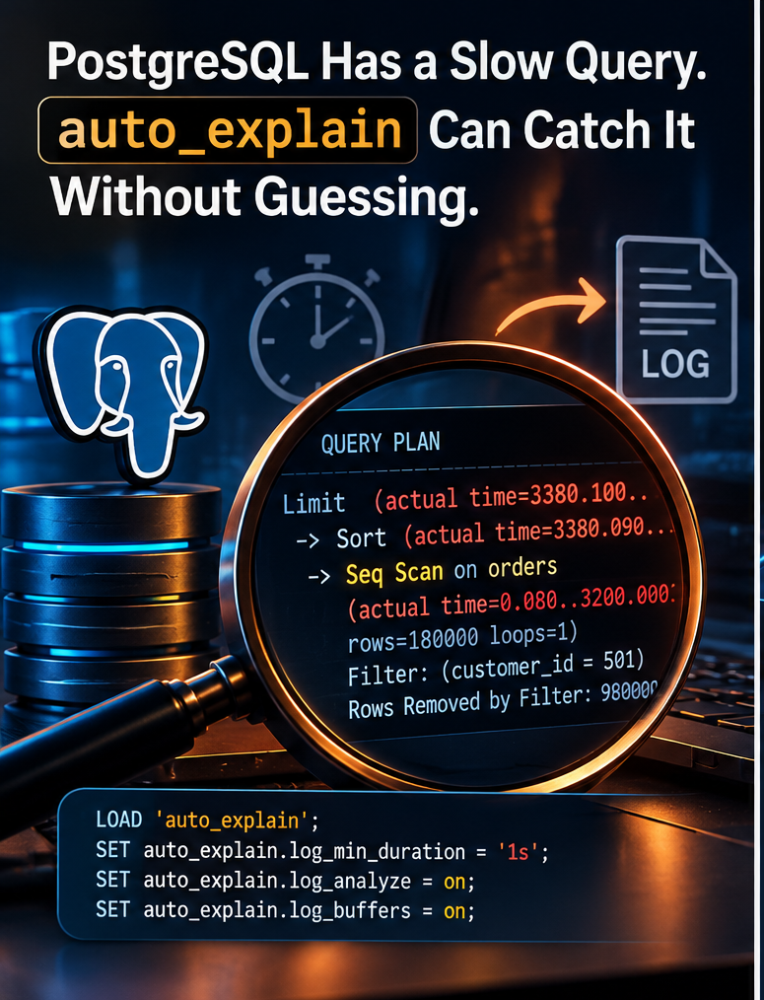

# "The Query Was Slow, but Now It's Fast." Meet PostgreSQL auto_explain

!!! info "Source"
    **techybob** on Medium · 25 Oct 2026 · 9 min read ·
    [Original article](https://medium.com/@techybob/the-query-was-slow-but-now-its-fast-meet-postgresql-auto-explain-7fdf104073bd)

**You cannot always reproduce a production slowdown in pgAdmin. PostgreSQL has a module that can automatically capture the execution plan when a query takes too long.**



The query was slow.

But nobody could reproduce it.

The support ticket looked familiar:

> *"The customer report takes 12 seconds sometimes. Other times, it finishes in less than a second."*

The developer opened the SQL in pgAdmin.

Ran it.

Fast.

Ran it again.

Still fast.

The DBA checked the indexes.

Nothing obviously wrong.

Statistics looked reasonable.

The query behaved perfectly while everyone was watching.

Then came the real question:

> **How do you inspect the execution plan of a query that is slow only when you're not watching it?**

You can run:

```sql
EXPLAIN (ANALYZE, BUFFERS)
```

But that only helps when you can reproduce the problematic execution.

Production incidents aren't always that cooperative.

The query may become slow only:

- For particular parameter values
- During peak traffic
- When the cache is cold
- When the system is under I/O pressure
- When data distribution changes
- When a different execution plan is selected
- For one execution out of thousands

By the time the DBA manually runs the query, the problem may have disappeared.

This is where PostgreSQL's `auto_explain` module becomes extremely useful.

## What Does auto_explain Actually Do?

Normally, if you want PostgreSQL to show how a query executes, you explicitly ask:

```sql
EXPLAIN (ANALYZE, BUFFERS)
SELECT * FROM orders WHERE customer_id = 501;
```

PostgreSQL executes the statement and shows you the plan.

That's great when you control the execution.

But imagine the problematic query comes from an application:

```text
Application
│
▼
PostgreSQL
│
├── Query → 120 ms
├── Query → 95 ms
├── Query → 140 ms
├── Query → 11.8 seconds ← WHAT HAPPENED HERE?
├── Query → 105 ms
└── Query → 130 ms
```

By the time you investigate, all you have is:

> *"One execution was really slow."*

What you actually want is the execution plan from that specific slow execution.

That's the problem `auto_explain` helps solve.

At a high level:

```text
                 Application Query
                        │
                        ▼
                    PostgreSQL
                        │
                        ▼
          Query exceeds configured
                 threshold?
                        │
                ┌───────┴───────┐
                │               │
               NO              YES
                │               │
                ▼               ▼
            Continue       Capture Plan
                                │
                                ▼
                         PostgreSQL Log
                                │
                                ▼
                        DBA Investigates
```

Think of it as an automatic plan recorder for slow queries.

## Step 1: Load auto_explain

For a controlled test, a sufficiently privileged user can load the module into the current session:

```sql
LOAD 'auto_explain';
```

That affects the current session.

It doesn't automatically mean every application connection will start recording plans.

For broader monitoring, `auto_explain` can be loaded for sessions through configuration such as:

```ini
session_preload_libraries
```

or more broadly:

```ini
shared_preload_libraries
```

The appropriate method depends on how you want to deploy the module and how your PostgreSQL environment is managed.

The important distinction is:

```text
LOAD 'auto_explain'
│
▼
Current session

session_preload_libraries
│
▼
New sessions

shared_preload_libraries
│
▼
Broader server-level preload
```

Don't jump directly to broad production enablement.

Start controlled.

Measure.

Then expand.

## Step 2: Decide What "Slow" Means

Loading the module isn't enough.

PostgreSQL needs to know when a query deserves an execution plan in the log.

For a controlled session, you might start with:

```sql
SET auto_explain.log_min_duration = '1s';
SET auto_explain.log_analyze = on;
SET auto_explain.log_buffers = on;
SET auto_explain.log_timing = off;
```

Let's unpack that.

### auto_explain.log_min_duration

```sql
SET auto_explain.log_min_duration = '1s';
```

This sets the execution-time threshold.

In this example, we're interested in statements reaching the one-second threshold.

The value should come from your workload and service expectations.

For one application:

```text
> 2 seconds = suspicious
```

For another:

```text
> 200 ms = unacceptable
```

There is no universal production threshold.

### auto_explain.log_analyze

```sql
SET auto_explain.log_analyze = on;
```

This is particularly useful because it allows execution statistics to appear in the logged plan.

Instead of knowing only what PostgreSQL expected, we can investigate what actually happened during execution.

That can expose major differences between:

```text
Estimated rows
     vs.
Actual rows
```

But there is a very important production warning.

Enabling `log_analyze` introduces instrumentation overhead.

And that overhead can affect statements even when they ultimately don't cross the logging threshold.

This is one reason `auto_explain` should not simply be enabled aggressively everywhere without testing.

### What About log_buffers?

```sql
SET auto_explain.log_buffers = on;
```

Buffer information can help answer another important question:

> *How much database work did this execution perform?*

When you're trying to understand why apparently similar SQL behaves differently in production, actual buffer activity can be extremely useful diagnostic evidence.

### Why Set log_timing = off?

```sql
SET auto_explain.log_timing = off;
```

Per-node timing measurements themselves can introduce additional overhead.

Turning them off can reduce instrumentation cost while still retaining valuable execution statistics.

But don't interpret this as:

> *`log_timing = off` means `auto_explain` has no overhead.*

It doesn't.

Good production diagnostics always involve a trade-off:

```text
More Observability
        ▲
        │
        │
        │
        ▼
  More Overhead
```

The objective is not to capture everything.

The objective is to capture enough evidence to diagnose the problem safely.

## Step 3: Wait for the Problem to Happen Naturally

Suppose the application normally runs this:

```sql
SELECT order_id, order_total, created_at
FROM orders WHERE customer_id = 501 ORDER BY created_at DESC
LIMIT 50;
```

Usually, it completes quickly.

But during a busy production period:

```text
Execution time: 3.4 seconds
```

With `auto_explain` configured appropriately, the PostgreSQL log can contain the execution plan from that actual execution.

A simplified, illustrative plan might look something like this:

```text
Limit
  (actual time=3380.100..3380.150 rows=50 loops=1)
  -> Sort
       (actual time=3380.090..3380.120 rows=50 loops=1)
       Sort Key: created_at DESC
       -> Seq Scan on orders
            (actual time=0.080..3200.000
             rows=180000 loops=1)
            Filter: (customer_id = 501)
            Rows Removed by Filter: 980000
```

*Illustrative output only, not a measured benchmark.*

Now we finally have something useful.

Not:

> *"The developer thinks it was slow."*

Not:

> *"It seems like an index problem."*

Not:

> *"Maybe PostgreSQL chose a strange plan."*

We have evidence from the slow execution.

## Step 4: Read the Evidence, Don't Jump to Conclusions

Look at our imaginary plan:

```text
Seq Scan on orders
```

A natural reaction is:

> *There's the problem! Sequential scan! Create an index!*

Slow down.

A sequential scan is not automatically bad.

PostgreSQL may correctly choose one if a sufficiently large proportion of the table needs to be read.

Instead, investigate what the plan is telling you.

### 1. Why was a sequential scan selected?

How selective is:

```sql
customer_id = 501
```

Are thousands of rows expected?

Millions?

### 2. How many rows were rejected?

Our example shows:

```text
Rows Removed by Filter: 980000
```

That's worth investigating.

### 3. What were the estimated versus actual rows?

Large estimation errors can influence plan decisions.

### 4. What happened during the sort?

Our query contains:

```sql
ORDER BY created_at DESC
LIMIT 50
```

Did PostgreSQL have to find a large result set and then sort it merely to return 50 rows?

## Could an Index Help?

Possibly.

For this particular access pattern, we might investigate something like:

```sql
CREATE INDEX idx_orders_customer_created
ON orders (customer_id, created_at DESC);
```

Conceptually, that gives PostgreSQL an access path aligned with:

```text
customer_id = ?
│
▼
created_at DESC
│
▼
LIMIT 50
```

Potentially allowing PostgreSQL to locate rows for the customer in the desired order efficiently.

But this article isn't saying:

> *See Seq Scan → Create index.*

The correct process is:

```text
Capture slow execution
│
▼
Inspect actual plan
│
▼
Understand cardinality
│
▼
Check selectivity
│
▼
Review buffer activity
│
▼
Evaluate alternative index/query
│
▼
Test
│
▼
Change production
```

The key difference is **evidence before action**.

## This Is Why auto_explain Is So Valuable

Suppose this happens:

```text
09:00 → Query takes 150 ms
09:05 → Query takes 120 ms
09:17 → Query takes 11.8 seconds
09:18 → Query takes 130 ms
09:30 → DBA investigates
```

At 09:30, manually executing:

```sql
EXPLAIN (ANALYZE, BUFFERS)
```

may simply show another fast execution.

You've reproduced the SQL.

You haven't necessarily reproduced the conditions of the incident.

`auto_explain` gives you the opportunity to retain plan evidence from the problematic execution itself.

That's much more interesting.

## Don't Turn Your Logs Into Another Production Problem

After discovering `auto_explain`, there is a tempting idea:

> *"Why don't we log execution plans for everything?"*

Because observability has a cost.

Capturing too much information can lead to:

```text
Aggressive auto_explain configuration
│
├── Instrumentation overhead
├── Increased log volume
├── Log storage growth
├── More log ingestion
├── Harder log analysis
└── Possible sensitive data exposure
```

The purpose is to investigate production.

Not to create another production incident while monitoring the first one.

## A More Controlled Starting Point

For a carefully tested rollout, you might evaluate settings along these lines:

```ini
session_preload_libraries = 'auto_explain'
auto_explain.log_min_duration = '2s'
auto_explain.log_analyze = on
auto_explain.log_buffers = on
auto_explain.log_timing = off
auto_explain.sample_rate = 0.1
```

This is illustrative, not a universal production recommendation.

A `sample_rate` of:

```text
0.1
```

means you're sampling approximately 10% of eligible executions for plan logging within the relevant sessions.

The point is to think in terms of controlled observability:

```text
Duration Threshold
        +
Sampling
        +
Required Plan Detail
        +
Log Capacity
        +
Measured Overhead
        =
Practical Production Monitoring
```

Measure what happens under representative workload. Then tune.

## Don't Forget About Parameter Values

Production query parameters can contain information you don't want sitting indefinitely in database logs.

Consider a query like:

```sql
SELECT * FROM customer_accounts WHERE email = $1;
```

Capturing diagnostic information without considering parameter logging can turn a performance-monitoring exercise into a data-governance problem.

Review settings such as:

```ini
auto_explain.log_parameter_max_length
```

along with your organization's log:

- Access controls
- Retention policy
- Redaction practices
- Forwarding pipeline
- Search permissions

Diagnostic logs are still production data.

Treat them accordingly.

## When Would I Reach for auto_explain?

I would consider it when:

### The slowdown is intermittent

```text
Fast
Fast
Fast
SLOW
Fast
Fast
```

and manual testing doesn't reproduce the problematic execution.

### Production behaves differently from development

The data volume, distribution, concurrency, cache behavior, resources, and parameter values may be completely different.

### Parameter values matter

Some parameter values may match a few rows.

Others may match millions.

Execution behavior can differ substantially.

### The application generates many queries

Manually running `EXPLAIN ANALYZE` against every suspected query isn't practical.

### I need evidence from real production executions

Sometimes the question isn't:

> *"What plan does this SQL normally use?"*

It's:

> *"What happened during the execution that took 12 seconds?"*

Those are not necessarily the same question.

## auto_explain vs pg_stat_statements

This is where PostgreSQL troubleshooting becomes much more interesting.

These tools solve related but different problems.

```text
pg_stat_activity
└── What is happening RIGHT NOW?

pg_stat_statements
└── Which SQL has consumed resources OVER TIME?

auto_explain
└── What plan was captured when the query met
    my logging criteria?

EXPLAIN (ANALYZE, BUFFERS)
└── What happens when I deliberately execute
    and measure this query?
```

They complement each other.

A practical investigation might look like this:

`pg_stat_statements` can help you identify which SQL deserves attention.

`auto_explain` can help you understand how qualifying executions were planned and executed.

That's a powerful combination.

## A Practical Production Checklist

Before enabling `auto_explain` broadly, I would check these seven things.

### 1. Verify availability

Make sure the module is available in your PostgreSQL environment.

### 2. Decide the scope

Do you need it for:

- One diagnostic session?
- Selected application sessions?
- A broader workload?

Don't automatically jump to maximum coverage.

### 3. Choose the threshold from the SLO

If your application expects queries to complete within 300 ms, a five-second threshold probably isn't useful.

Make "slow" correspond to the system you're operating.

### 4. Measure instrumentation overhead

Especially when using:

```ini
auto_explain.log_analyze
```

Test under representative load.

### 5. Protect sensitive information

Review parameter logging and log access.

### 6. Watch log volume

Make sure your logging pipeline can:

- Store the plans
- Search them
- Retain them
- Rotate logs appropriately
- Handle plan size

### 7. Change production only after interpreting the evidence

Don't follow:

```text
Seq Scan
   ↓
CREATE INDEX
```

Follow:

```text
Slow Execution
      ↓
Captured Plan
      ↓
Evidence
      ↓
Hypothesis
      ↓
Test
      ↓
Production Change
      ↓
Measure Again
```

That's the DBA workflow.

## The Real-World Troubleshooting Pattern

The next time someone says:

> *"This query is slow sometimes, but every time we test it manually it's fast."*

Don't immediately start guessing.

Think about the evidence you actually need:

```text
              INTERMITTENT SLOW QUERY
                        │
                        ▼
            Can I reproduce it safely?
                        │
                ┌───────┴───────┐
                │               │
               YES              NO
                │               │
                ▼               ▼
          EXPLAIN             Consider
     (ANALYZE, BUFFERS)      auto_explain
                │               │
                └───────┬───────┘
                        │
                        ▼
              Understand the Plan
                        │
                        ▼
             Validate the Root Cause
                        │
                        ▼
                  Fix + Measure
```

## Final Thought

The hardest production queries are often the ones that behave perfectly when the DBA arrives.

You can stare at the SQL.

You can inspect the indexes.

You can run `EXPLAIN ANALYZE`.

But if the problem occurred three hours earlier under different runtime conditions, you may simply be examining a different execution.

That's why `auto_explain` is worth knowing.

It allows PostgreSQL to preserve execution-plan evidence when statements meet criteria you define.

Instead of asking:

> *"What do we think happened?"*

you have a better chance of asking:

> **"What does the captured plan tell us happened?"**

And that changes the investigation completely.

Don't wait until the slow query appears on command.

Arrange for PostgreSQL to leave evidence behind when it happens.
