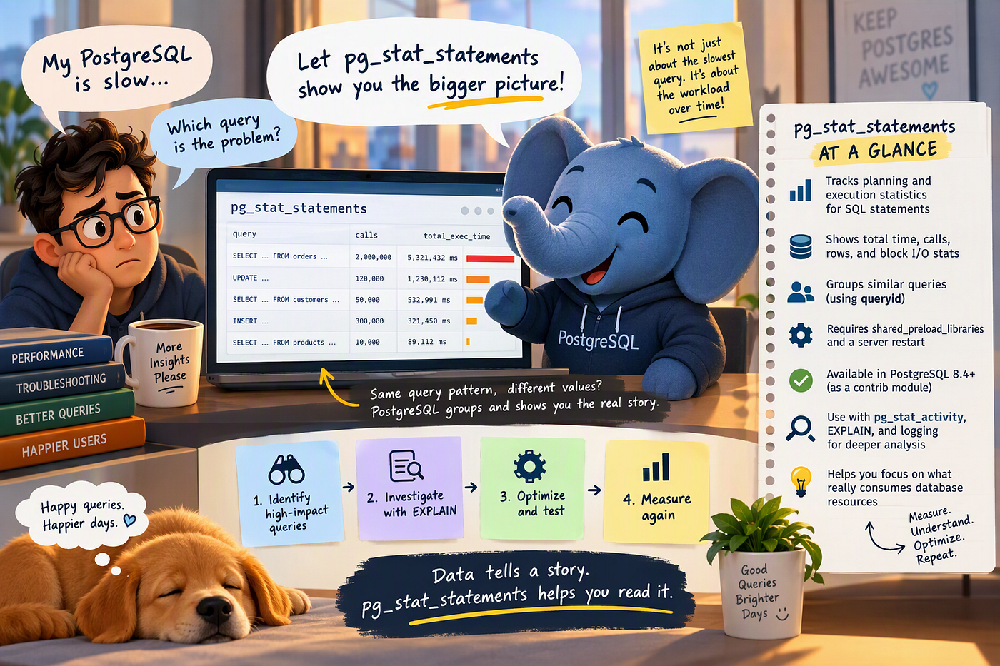

# pg_stat_statements: The PostgreSQL Extension I Wish I Had Enabled Before the Database Became Slow

!!! info "Source"
    **techybob** on Medium · 22 Oct 2026 · 11 min read ·
    [Original article](https://medium.com/@techybob/pg-stat-statements-the-postgresql-extension-i-wish-i-had-enabled-before-the-database-became-slow-17c511d88d0b)

**Your PostgreSQL database is slow. CPU is high. Users are complaining. But which SQL statement is actually responsible?**



Imagine this.

It is Monday morning.

Your application normally works fine, but suddenly the database CPU starts climbing.

The application team says:

> *“PostgreSQL is slow.”*

You connect to the database and check active sessions.

```sql
SELECT
pid,
usename,
state,
query_start,
query
FROM pg_stat_activity
WHERE state <> 'idle';
```

You find several queries running.

But there is a problem.

**The query causing today’s CPU spike may not be running when you look.**

Perhaps it executes in 300 milliseconds.

That doesn’t look particularly alarming.

But suppose it executes 2 million times per day.

Then the real question is no longer:

> “Which query is slow right now?”

It becomes:

> “Which queries have been consuming PostgreSQL resources over time?”

That is exactly the kind of problem `pg_stat_statements` is designed to help investigate.

According to the official PostgreSQL documentation, `pg_stat_statements` tracks planning and execution statistics for SQL statements executed by a server.

And that makes it one of the first places I would look when troubleshooting query workload.

## 1. What Exactly Is pg_stat_statements?

`pg_stat_statements` is an additional module supplied with PostgreSQL.

When active, it collects statistics about SQL statements executed by the server. Current PostgreSQL documentation describes the statistics as being tracked across all databases of the server. The view is made available to a particular database through `CREATE EXTENSION pg_stat_statements`.

Think of the difference like this:

```text
pg_stat_activity
│
▼
"What is happening right now?"

pg_stat_statements
│
▼
"What SQL workload has been happening over time?"
```

`pg_stat_activity` exposes dynamic information about sessions and currently executing commands. PostgreSQL's statistics documentation explicitly distinguishes this current-activity information from its cumulative statistics facilities.

That distinction becomes extremely useful in production.

## 2. A Real-World Scenario: The Query That Isn’t Actually “Slow”

Suppose an API executes:

```sql
SELECT customer_name, status
FROM customers
WHERE customer_id = $1;
```

Imagine its average runtime is only:

```text
5 ms
```

Sounds harmless.

But suppose your application executes it:

```text
4,000,000 times
```

Now compare it with a reporting query:

```text
Execution time: 30 seconds
Executions: 5
```

Which query deserves attention first?

It depends.

The report is obviously slow per execution.

But the tiny customer lookup may represent much more accumulated work.

This is where `pg_stat_statements` changes how you think about database performance.

Instead of asking only:

> Which query has the highest latency?

you can start asking:

- Which query consumes the most total execution time?
- Which query executes most frequently?
- Which queries read the most blocks?
- Which queries spill heavily to temporary blocks?

The current `pg_stat_statements` view exposes metrics including calls, execution time, rows, shared/local/temp block activity and, depending on configuration, planning and I/O timing statistics.

## 3. First, Is pg_stat_statements Already Available?

Start with:

```sql
SELECT version();
```

Then check installed extensions:

```sql
SELECT * FROM pg_extension
WHERE extname = 'pg_stat_statements';
```

You can also inspect the preload setting:

```sql
SHOW shared_preload_libraries;
```

This second check matters.

`pg_stat_statements` requires additional shared memory, so the official documentation requires it to be loaded through `shared_preload_libraries`. Adding or removing it there therefore requires a server restart.

A typical configuration includes:

```ini
shared_preload_libraries = 'pg_stat_statements'
```

After the required restart, enable its SQL objects in the database:

```sql
CREATE EXTENSION pg_stat_statements;
```

One subtle but important point is that the module tracks server-wide statistics when active, while its views and functions become accessible in databases where the extension has been created.

## 4. The First Query I Would Run

Once statistics have accumulated, start simple:

```sql
SELECT * FROM pg_stat_statements LIMIT 10;
```

Do not immediately build a massive monitoring query.

First understand the columns available in your PostgreSQL version.

That last part is important because `pg_stat_statements` has evolved considerably across PostgreSQL releases.

Current PostgreSQL exposes far more information than early implementations.

## 5. Find SQL Consuming the Most Total Execution Time

For a current PostgreSQL release, one useful investigation is:

```sql
SELECT
query,
calls,
total_exec_time,
mean_exec_time,
rows
FROM pg_stat_statements
ORDER BY total_exec_time DESC
LIMIT 10;
```

Why start with `total_exec_time`?

Because production performance problems are not always caused by one spectacularly slow query.

Sometimes the bigger problem is:

```text
Query A
Average time: 2 seconds
Calls: 20

Query B
Average time: 25 ms
Calls: 2,000,000
```

Query A attracts attention.

Query B may quietly consume vastly more execution time.

This gives us our first practical rule:

> **Don’t investigate only the slowest query. Investigate the workload consuming the most total database time.**

PostgreSQL documents both execution counts and execution-time statistics in the current `pg_stat_statements` view.

## 6. Find the Most Frequently Executed SQL

Now change the question.

Instead of:

> “What consumes the most time?”

ask:

> “What does my application ask PostgreSQL to do most often?”

```sql
SELECT
query,
calls,
mean_exec_time,
total_exec_time
FROM pg_stat_statements
ORDER BY calls DESC
LIMIT 10;
```

This can reveal an application behavior that is easy to miss.

For example:

```text
Application Request
│
├── SQL #1
├── SQL #2
├── SQL #3
├── SQL #4
├── SQL #5
└── SQL #6
```

Perhaps the individual statements are fast.

But an application endpoint might simply be making far more database calls than expected.

`calls` gives you the number of times a statement represented by that statistics entry was executed.

That can point the investigation toward application behavior rather than immediately toward PostgreSQL configuration.

## 7. The Clever Part: PostgreSQL Normalizes Queries

Suppose your application executes:

```sql
SELECT * FROM orders WHERE order_id = 101;
```

Then:

```sql
SELECT * FROM orders WHERE order_id = 102;
```

Then:

```sql
SELECT * FROM orders WHERE order_id = 103;
```

You generally do not want thousands of separate entries purely because literal values differ.

Current PostgreSQL computes a `queryid` that identifies normalized queries, and representative query text is stored in the view. The documentation explains how constants are replaced in the query representation so that structurally equivalent statements can be grouped. Conceptually:

```text
SELECT … WHERE order_id = 101
SELECT … WHERE order_id = 102
SELECT … WHERE order_id = 103
│
▼
Normalized statement
│
▼
Calls / Time / Rows / I/O statistics
```

That is one reason `pg_stat_statements` is so useful for workload analysis.

You investigate **query patterns**, not merely individual literal values.

## 8. “The Query Is Slow” Could Actually Mean “The Query Is Reading Too Much”

Execution time tells you that something is expensive.

It doesn’t necessarily tell you **why**.

`pg_stat_statements` also exposes block-related counters, including:

- `shared_blks_hit`
- `shared_blks_read`
- `shared_blks_dirtied`
- `shared_blks_written`
- `temp_blks_read`
- `temp_blks_written`

These fields are documented as part of the current view.

For example:

```sql
SELECT
query,
calls,
shared_blks_hit,
shared_blks_read,
temp_blks_read,
temp_blks_written
FROM pg_stat_statements
ORDER BY shared_blks_read DESC
LIMIT 10;
```

Now your investigation can evolve from:

```text
This query is expensive
to:
This query is expensive
│
▼
What resources is it consuming?
│
├── Shared block reads
├── Shared block hits
└── Temporary blocks
```

That gives you a much better starting point for deeper diagnosis.

## 9. Another Real-World Scenario: Temporary I/O

Imagine that an application works well most of the day.

But whenever a large reporting process starts, database latency rises.

You investigate:

```sql
SELECT
query,
calls,
temp_blks_read,
temp_blks_written,
total_exec_time
FROM pg_stat_statements
ORDER BY temp_blks_written DESC
LIMIT 10;
```

One query stands out with significant temporary block activity.

That doesn’t automatically tell you the root cause.

But it gives you a candidate.

Now you can investigate that statement using PostgreSQL’s next diagnostic tool:

```sql
EXPLAIN (ANALYZE, BUFFERS)
SELECT …
```

`EXPLAIN` shows the execution plan chosen by PostgreSQL, including scan and join strategies. With `ANALYZE`, PostgreSQL actually executes the statement and reports runtime information for plan nodes.

This suggests a useful workflow:

```text
pg_stat_statements
│
▼
Identify expensive query pattern
│
▼
EXPLAIN / EXPLAIN ANALYZE
│
▼
Understand execution plan
│
▼
Investigate tables / indexes / estimates
│
▼
Optimize
│
▼
Measure again
```

Do remember that `EXPLAIN ANALYZE` executes the statement. PostgreSQL specifically warns that side effects still occur for data-changing statements, and documents the `BEGIN; EXPLAIN ANALYZE ...; ROLLBACK;` approach when appropriate.

## 10. Don’t Forget I/O Timing

PostgreSQL provides the `track_io_timing` configuration parameter.

When enabled, PostgreSQL measures I/O timing, and that timing information is exposed in several places including `pg_stat_statements`. However, PostgreSQL's documentation also warns that obtaining system time repeatedly can introduce significant overhead on some platforms. It recommends `pg_test_timing` for evaluating timing overhead.

Check it with:

```sql
SHOW track_io_timing;
```

If it is appropriate for your environment, I/O timing can add another useful dimension to the investigation.

But don’t enable instrumentation blindly.

Measurements have a cost too.

## 11. Planning Time Is a Separate Question

Execution isn’t the only work involved in a query.

Current PostgreSQL versions can also collect planning statistics through `pg_stat_statements.track_planning`. When planning tracking is enabled, the view includes measures such as the number of plans and planning-time statistics.

This becomes interesting for workloads involving many rapidly executed statements.

Check the setting:

```sql
SHOW pg_stat_statements.track_planning;
```

Again, instrumentation choices should be deliberate. The PostgreSQL documentation cautions that enabling planning tracking can incur noticeable performance cost under certain workloads, particularly with many identical queries competing to update their statistics entries.

## 12. But pg_stat_statements Does Not Keep Infinite History

Here is an important misconception:

```text
pg_stat_statements ≠ Permanent query-history warehouse
```

The module has a configurable maximum number of statements it tracks:

```ini
pg_stat_statements.max
```

When the number of distinct statements exceeds what can be retained, less-executed statements may be discarded. PostgreSQL exposes information about discarded entries through `pg_stat_statements_info`.

That matters in applications that generate huge numbers of structurally different SQL statements.

Check:

```sql
SELECT * FROM pg_stat_statements_info;
```

If entries are being deallocated aggressively, the statistics you see may not represent every statement that has appeared since collection began.

## 13. Be Careful When Resetting Statistics

PostgreSQL provides:

```sql
SELECT pg_stat_statements_reset();
```

The reset function discards collected `pg_stat_statements` statistics, subject to the function's parameters and privileges in current versions.

Operationally, that means a reset changes your measurement baseline.

Imagine:

```text
Monday Tuesday Wednesday
│        │         │
└────── accumulated data ──────────┘
│
RESET
│
▼
New measurement
```

So if you’re comparing workload behavior before and after an application deployment, be deliberate about when you reset.

Otherwise you can destroy exactly the baseline you wanted to compare against.

## 14. pg_stat_statements vs pg_stat_activity

These two are often confused.

A practical way to think about them is:

| Question | PostgreSQL facility |
|---|---|
| What is executing right now? | `pg_stat_activity` |
| Which sessions are connected? | `pg_stat_activity` |
| Which query patterns have executed repeatedly? | `pg_stat_statements` |
| Which statements accumulated substantial execution time? | `pg_stat_statements` |
| Which statements performed significant block I/O? | `pg_stat_statements` |
| How does a particular query execute? | `EXPLAIN` / `EXPLAIN ANALYZE` |

PostgreSQL documents `pg_stat_activity` as a source of current backend activity, while `pg_stat_statements` provides accumulated planning/execution statistics for statements. `EXPLAIN` then exposes the query's execution plan.

You can therefore think about troubleshooting as three different questions:

```text
                  PostgreSQL is slow
                         │
                         ▼
             What do we need to know?
                         │
              ┌──────────┴──────────┐
              ▼                     ▼
     What's happening        What has consumed
        right now?          resources over time?
              │                     │
              ▼                     ▼
       pg_stat_activity      pg_stat_statements
                                    │
                                    ▼
                          Which SQL is suspicious?
                                    │
                                    ▼
                                 EXPLAIN
                                    │
                                    ▼
                          Why is it expensive?
```

## 15. What If pg_stat_statements Is Not Available in My PostgreSQL Version?

This is where the history is interesting.

`pg_stat_statements` is not a recent PostgreSQL feature.

According to PostgreSQL’s official 8.4 release notes, `pg_stat_statements` was introduced as a new contrib module in PostgreSQL 8.4, released in 2009. `auto_explain` was introduced as a contrib module in the same release.

And the PostgreSQL 8.4 documentation already describes `pg_stat_statements` as a module for tracking execution statistics for SQL statements.

Therefore:

```text
PostgreSQL 8.4+
│
├── pg_stat_statements available as supplied/contrib module
│
▼
Modern releases
│
└── Much richer pg_stat_statements statistics
```

However, an extremely old PostgreSQL installation may predate 8.4, or a packaged/managed environment may not make the module available to you.

Also, PostgreSQL 8.4 itself is long unsupported. The currently supported versions listed by PostgreSQL are 14 through 18 as of the documentation retrieved here.

For an environment old enough not to have `pg_stat_statements`, upgrading should be part of the architectural conversation rather than treating the absence of the extension as only a monitoring inconvenience.

## 16. What Are the Alternatives If I Cannot Use pg_stat_statements?

There isn’t one built-in feature that is an exact drop-in replacement.

Instead, use different PostgreSQL-native facilities depending on the question you’re trying to answer.

### Alternative 1: pg_stat_activity

Use this when you need:

> “What is happening right now?”

`pg_stat_activity` reports information about server processes, sessions and current activity.

```sql
SELECT
pid,
usename,
state,
query_start,
query
FROM pg_stat_activity
WHERE state <> 'idle';
```

**Limitation:** This is not equivalent to the accumulated per-statement workload statistics maintained by `pg_stat_statements`.

### Alternative 2: PostgreSQL Logging

If your goal is to capture slow SQL, PostgreSQL’s logging configuration provides parameters for statement-duration logging and several output formats. Current PostgreSQL supports destinations including `stderr`, `csvlog`, `jsonlog` and `syslog`, with `eventlog` also available on Windows.

This changes the approach from:

```text
Aggregate query statistics
to:
Execute Query
│
▼
PostgreSQL Log
│
▼
Analyze captured statements
```

That can be useful when persistent SQL logging is more important than an in-memory aggregated workload view.

### Alternative 3: auto_explain

Sometimes knowing that a statement is slow isn’t enough.

You really want:

> “What execution plan did PostgreSQL use when the slow query happened?”

That’s where `auto_explain` becomes interesting.

The official documentation describes `auto_explain` as a module for automatically logging execution plans of slow statements without manually executing `EXPLAIN`. PostgreSQL specifically calls it useful for tracking unoptimized queries in large applications.

For example, the documentation describes configuring a duration threshold such as:

```ini
auto_explain.log_min_duration = 250ms
```

which causes statements at or above that duration threshold to have their plans logged once the module is appropriately loaded.

But there is an important warning.

Enabling:

```ini
auto_explain.log_analyze = on
```

can cause substantial overhead because per-node timing can occur for statements even when they do not ultimately meet the logging threshold. The PostgreSQL docs explicitly warn that this can have an extremely negative impact on performance and note that disabling `auto_explain.log_timing` can reduce that cost.

Use it deliberately.

### Alternative 4: EXPLAIN

If you already know the suspicious SQL, use:

```sql
EXPLAIN SELECT …;
```

or, when appropriate:

```sql
EXPLAIN (ANALYZE, BUFFERS) SELECT …;
```

`EXPLAIN` tells you how PostgreSQL plans to scan tables and combine them, while `ANALYZE` actually executes the statement and adds real runtime statistics.

Think of the tools this way:

```text
PostgreSQL Performance Toolbox
│
├── pg_stat_activity
│   └── What is happening RIGHT NOW?
│
├── pg_stat_statements
│   └── What SQL has consumed resources OVER TIME?
│
├── auto_explain
│   └── Capture execution plans of slow SQL AUTOMATICALLY
│
├── EXPLAIN / EXPLAIN ANALYZE
│   └── Why does THIS particular query behave this way?
│
└── PostgreSQL logs
    └── Which individual statements or events were LOGGED?
```

They solve different parts of the troubleshooting problem.

## 17. My Practical PostgreSQL Troubleshooting Flow

If an application team tells me:

> “The database has become slow.”

I wouldn’t immediately start creating indexes.

I’d work through the problem like this:

```text
                         DATABASE SLOW
                              │
                              ▼
                    Check pg_stat_activity
                              │
                              ▼
                 Is the problem visible NOW?
                         │           │
                        YES          NO
                         │           │
                         ▼           ▼
              Investigate active    Check
               queries / waits      pg_stat_statements
                                         │
                                         ▼
                              Look for workload signals
                                         │
                              ┌──────────┼──────────┐
                              ▼          ▼          ▼
                       High total    High calls   High reads /
                       exec time                  temp activity
                              └──────────┼──────────┘
                                         │
                                         ▼
                              Identify candidate SQL
                                         │
                                         ▼
                                      EXPLAIN
                              EXPLAIN ANALYZE*
```

\* `EXPLAIN ANALYZE` actually executes the statement.

This is a much safer production mindset than:

```text
Query slow
↓
Create index
↓
Hope
```

## 18. The Most Important Lesson

`pg_stat_statements` does not magically tell you:

> “Create this index.”

It gives you something more valuable:

**evidence about where your SQL workload is spending its effort.**

That distinction matters.

A production PostgreSQL problem might be caused by:

- One genuinely expensive query
- A moderately expensive query executed millions of times
- Excessive block reads
- Temporary I/O
- An application making far too many database calls
- A bad execution plan
- A workload problem that isn’t actually about an individual query at all

`pg_stat_statements` helps narrow the field.

Then PostgreSQL’s other monitoring facilities and `EXPLAIN` help you go deeper.

## Final Thought

The next time someone says:

> “PostgreSQL is slow.”

don’t start with:

> “Which index should we create?”

Start with:

> **“Which SQL statements are actually consuming the database?”**

That small change turns query tuning from guesswork into investigation.

And that is where `pg_stat_statements` becomes one of the most useful tools in the PostgreSQL troubleshooting toolbox.
