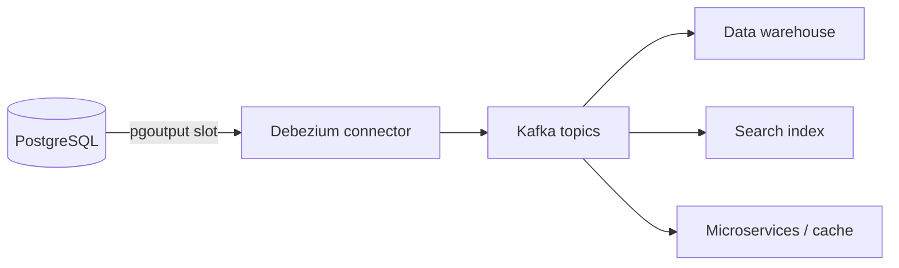

# Alternatives and related tools

| Tool | Type | Use it for | Instead of logical replication when… |
|---|---|---|---|
| Physical streaming replication | Core, block-level | HA, read replicas, DR | You want an exact, whole-cluster copy |
| pglogical | Extension | PG → PG with extra features | You're on PG < 10, or need its conflict resolution / sequence sync |
| Debezium | CDC platform (Kafka Connect) | Streaming changes to Kafka / other systems | The target is not PostgreSQL |
| AWS DMS | Managed migration service | Heterogeneous migrations, AWS targets | Source or target is not PostgreSQL |
| Foreign data wrappers | Query federation | Querying / pulling remote data | You need on-demand access, not continuous replication |

## Physical streaming replication

- Ships WAL **bytes**; the standby is an exact, read-only copy of the **whole cluster**.
- Replicates everything: DDL, sequences, large objects, all databases.
- Simple failover (`pg_ctl promote` / Patroni / RDS Multi-AZ).
- Same major version and platform required.
- Often **combined** with logical replication: physical standbys for HA of the publisher, logical replication for upgrades/selective copies. With PG 17 failover slots, logical replication survives physical failovers.

Choose physical for **HA and DR**; logical for **upgrades, migrations and selective replication**.

## pglogical

Extension originally by 2ndQuadrant (now EDB); the code that native logical replication was largely based on.

- Works on PG 9.4+ (useful for upgrading **from** very old versions).
- **Sequence** synchronisation (`pglogical.synchronize_sequence`).
- Configurable **conflict resolution** (`error`, `apply_remote`, `keep_local`, `last_update_wins`, `first_update_wins`).
- Row filtering and column filtering (long before PG 15).
- Replication sets, and DDL replication via a helper function (`pglogical.replicate_ddl_command`).
- Available on RDS/Aurora and other managed services.

Downsides: an extra extension to install on both sides, needs `shared_preload_libraries`, and less active development than core. For PG 15+ → PG 15+, native logical replication covers most use cases.

## Debezium / CDC pipelines

[Debezium](https://debezium.io/) reads PostgreSQL logical decoding (`pgoutput`) and publishes change events to **Kafka** (or other sinks via Debezium Server).



- One change event per row, with before/after images and metadata (LSN, transaction ID, timestamp).
- Initial snapshot followed by streaming.
- Uses a publication + slot on the source: **the same slot risks apply**. A stopped connector retains WAL.
- Good for event-driven architectures, feeding non-PG systems, audit streams.
- Related: Kafka Connect JDBC sink to write back to PostgreSQL, Flink CDC, Estuary, Airbyte, Fivetran (managed CDC products using logical decoding).

## AWS DMS

- Managed service with a **replication instance** that reads the source and writes the target.
- Supports full load + ongoing CDC from PostgreSQL via logical decoding (`test_decoding`, or `pglogical` plugin).
- Heterogeneous: PG → Redshift, S3, Aurora MySQL, Kinesis, etc.
- Built-in data validation and transformation rules.
- Limitations for PG → PG: data type edge cases (LOB handling, arrays, PostGIS), no DDL by default, extra cost.

See [Managed-service specifics (AWS) › DMS vs native](managed-service-specifics-aws.md#using-dms-vs-native-logical-replication).

## Foreign data wrappers

`postgres_fdw` lets one database **query** tables in another:

```sql
CREATE EXTENSION postgres_fdw;
CREATE SERVER old_db FOREIGN DATA WRAPPER postgres_fdw OPTIONS (host 'old', dbname 'app');
CREATE USER MAPPING FOR app_user SERVER old_db OPTIONS (user 'app_user', password '...');
IMPORT FOREIGN SCHEMA app FROM SERVER old_db INTO old_app;

-- one-off or incremental pull
INSERT INTO app.orders SELECT * FROM old_app.orders WHERE id > (SELECT max(id) FROM app.orders);
```

- No slots, no WAL retention, no continuous replication.
- Good for **one-off data moves**, small reference tables, ad-hoc comparisons (e.g. verifying row counts between publisher and subscriber), or incremental copies keyed by timestamp/ID.
- Not transactional with the source, and slow for large volumes.

See the [postgres_fdw extension page](../../extensions/postgres-fdw/index.md).
