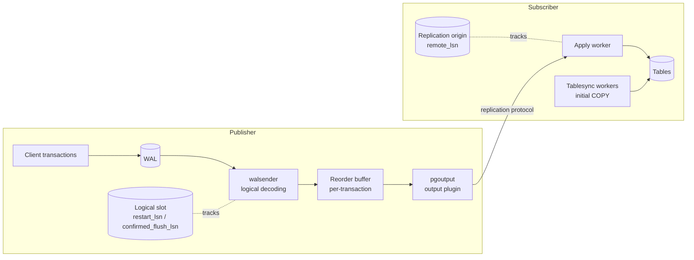

# How does logical replication work?

## Architecture overview (WAL to apply)



The pipeline end to end:

1. A client commits a transaction on the publisher; its changes are written to WAL as normal.
2. A **walsender** process, serving the subscription's connection, reads the WAL through a **logical replication slot**.
3. **Logical decoding** turns WAL records into row changes and collects them per transaction in the **reorder buffer**.
4. On commit, the transaction's changes are passed to the **output plugin** (`pgoutput`), which filters them by publication and serialises them.
5. The changes are streamed to the subscriber over the replication protocol.
6. The subscriber's **apply worker** applies them as a local transaction and records progress in a **replication origin**.
7. The subscriber reports its flushed position back; the publisher advances the slot's `confirmed_flush_lsn` so WAL can be recycled.

## wal_level = logical and WAL volume impact

Logical decoding needs extra information in the WAL that `replica` level doesn't write:

- The **old key values** (replica identity columns) for `UPDATE` and `DELETE`, or the whole old row with `REPLICA IDENTITY FULL`.
- Extra information for **catalog changes** so the decoder can reconstruct the table definitions at any point in time.

```sql
-- requires a restart
ALTER SYSTEM SET wal_level = logical;
SHOW wal_level;
```

Impact:

- Usually a **modest increase** in WAL volume (often single-digit percent) for tables with a primary key.
- **Large increase** for tables with `REPLICA IDENTITY FULL` and heavy `UPDATE`/`DELETE` traffic: the full old row is logged for each change.
- `wal_level = logical` on its own costs little; the real risk is **slots that retain WAL** (see [Replication slots](replication-slots.md)).

## Logical decoding and the reorder buffer

WAL is written in the order changes happen, with many transactions interleaved. Subscribers need **whole transactions in commit order**.

The **reorder buffer** solves this:

- Each change is added to an in-memory buffer keyed by transaction ID (including subtransactions).
- When the transaction commits, its changes are sent to the output plugin as one unit.
- Aborted transactions are discarded and never sent.
- If the memory used exceeds `logical_decoding_work_mem` (default `64MB`), the largest transaction is **spilled to disk** under `pg_replslot/<slot_name>/`, or **streamed** to the subscriber if streaming is enabled.

Consequence: by default a transaction is not sent until it **commits**, so a one-hour batch job shows up on the subscriber as one large burst after it finishes.

## Snapshot building and catalog visibility

To decode a WAL record into "table `orders`, columns `id, total`", the decoder needs the catalog **as it was when the change happened**, not as it is now. Logical decoding therefore:

- Uses a **historic snapshot** of the system catalogs for each change.
- Holds back removal of old catalog rows via the slot's **`catalog_xmin`**. Vacuum cannot remove dead catalog tuples newer than this.

When a slot is created, the **snapshot builder** waits until it reaches a *consistent point*: a moment where it knows about all running transactions. Slot creation can therefore hang if there are long-running transactions on the publisher.

!!! warning
    A forgotten logical slot holds back `catalog_xmin`, causing **catalog bloat** (`pg_class`, `pg_attribute`, …) as well as WAL retention.

## Output plugins (pgoutput, wal2json, test_decoding)

The output plugin decides the format of the decoded changes.

| Plugin | Shipped with | Format | Used by |
|---|---|---|---|
| `pgoutput` | Core | Binary logical replication protocol | Built-in subscriptions, Debezium, many CDC tools |
| `test_decoding` | contrib | Human-readable text | Testing, debugging, AWS DMS (option) |
| `wal2json` | Third party | JSON | CDC pipelines, custom consumers |
| `decoderbufs` | Third party | Protocol Buffers | Older Debezium setups |

Peek at changes with `test_decoding`:

```sql
SELECT pg_create_logical_replication_slot('debug_slot', 'test_decoding');

-- make some changes, then:
SELECT * FROM pg_logical_slot_peek_changes('debug_slot', NULL, NULL);

-- always clean up
SELECT pg_drop_replication_slot('debug_slot');
```

## Walsender and the replication protocol

- The subscriber connects with `replication=database` in its connection string. The postmaster starts a **walsender** process for it.
- The walsender accepts replication commands such as `CREATE_REPLICATION_SLOT`, `START_REPLICATION SLOT ... LOGICAL ...` and `IDENTIFY_SYSTEM`.
- Each subscription uses one walsender for the apply worker, plus one per active tablesync worker.
- Visible on the publisher in `pg_stat_replication` (with `backend_type = 'walsender'` in `pg_stat_activity`).
- Keepalive messages flow both ways; `wal_sender_timeout` / `wal_receiver_timeout` end dead connections.

## Initial table synchronisation (tablesync workers, COPY)

When a subscription is created (with `copy_data = true`) or tables are added via `REFRESH PUBLICATION`:

1. The apply worker starts a **tablesync worker** per table, limited by `max_sync_workers_per_subscription` (default 2).
2. The tablesync worker creates its own short-lived slot on the publisher (`pg_<subid>_sync_<relid>_<sysid>`) and runs `COPY ... TO STDOUT` to copy the existing rows.
3. When `COPY` finishes, it replays changes from its slot until it catches up with the main apply worker's position.
4. The table is handed over to the main apply worker and becomes `ready`.

Per-table state in `pg_subscription_rel.srsubstate`:

| Code | State |
|---|---|
| `i` | initialize |
| `d` | data is being copied |
| `f` | finished table copy (PG 14+) |
| `s` | synchronized |
| `r` | ready (normal replication) |

See the [Logical Replication SQL](../sql/logical-replication-queries.md) page for a query that shows this per table.

!!! tip
    Large tables copy fastest with **no secondary indexes** on the subscriber. Create the indexes after the initial sync, or at least drop non-essential ones.

## Apply workers and the apply process

- One **apply worker** per enabled subscription (a background worker on the subscriber).
- It receives changes and applies them by directly calling executor routines. It does **not** go through SQL parsing; triggers fire only if set to `ENABLE REPLICA` or `ENABLE ALWAYS`.
- Changes are applied with `session_replication_role = replica`, so normal triggers and FK triggers **don't fire** by default.
- For `UPDATE`/`DELETE` it finds the target row by the **replica identity** columns, via the primary key or replica identity index if one exists, otherwise via a sequential scan.
- By default the apply worker processes **one transaction at a time**, in publisher commit order. This is the main throughput limit. See [Parallel apply](#parallel-apply).
- Progress is recorded in a **replication origin** so it can restart from the correct position after a crash.

## Streaming in-progress transactions and logical_decoding_work_mem

Since PG 14 large transactions can be **streamed before commit** instead of spilling to disk on the publisher:

```sql
CREATE SUBSCRIPTION sub ... WITH (streaming = on);
-- or, PG 16+
ALTER SUBSCRIPTION sub SET (streaming = parallel);
```

- Triggered when the reorder buffer exceeds `logical_decoding_work_mem`.
- With `streaming = on` the subscriber writes the streamed changes to temporary files and applies them at commit.
- If the transaction aborts on the publisher, the subscriber discards them.
- Reduces publisher disk spill and makes commit-time lag much smaller for big transactions.
- PG 18 changed the default `streaming` value for new subscriptions to `parallel`.

```sql
-- publisher: how much decoding is spilling vs streaming
SELECT slot_name, spill_txns, spill_count, pg_size_pretty(spill_bytes) AS spill,
       stream_txns, stream_count, pg_size_pretty(stream_bytes) AS streamed
FROM pg_stat_replication_slots;
```

## Parallel apply

PG 16 added `streaming = parallel`:

- Large streamed transactions are applied **while they are still streaming**, by **parallel apply workers**, instead of being written to a file first.
- Number of workers limited by `max_parallel_apply_workers_per_subscription` (default 2), drawn from `max_logical_replication_workers`.
- Commit order is still preserved. Small transactions are still applied serially by the leader apply worker.
- If a parallel worker would deadlock or hit a problem, it falls back to serial apply for that transaction.

!!! note
    Parallel apply speeds up **large** transactions. It does **not** parallelise a stream of many small transactions; that remains single-threaded.

## Two-phase commit / prepared transactions

By default, a `PREPARE TRANSACTION` on the publisher is sent only once `COMMIT PREPARED` happens. With `two_phase = true` (PG 15+):

```sql
CREATE SUBSCRIPTION sub ... WITH (two_phase = true);
```

- The transaction is decoded and sent at `PREPARE` time and prepared on the subscriber too.
- `COMMIT PREPARED` / `ROLLBACK PREPARED` are then replicated.
- Requires `max_prepared_transactions > 0` on the subscriber.
- Before PG 18, `two_phase` could only be set at creation time; PG 18 allows changing it with `ALTER SUBSCRIPTION` (while disabled).
- Mainly useful for distributed-transaction setups; most deployments leave it off.

## Transaction ordering and consistency guarantees

- Transactions are applied on the subscriber **in the order they committed** on the publisher.
- Each transaction is applied **atomically**: the subscriber never sees half a publisher transaction.
- The subscriber is **eventually consistent**; it can be behind by any amount.
- There is **no consistency across subscriptions**: two subscriptions replicating different tables can be at different points in time.
- Writes made locally on the subscriber are not coordinated with the publisher. Conflicting local writes cause [conflicts](conflicts-and-error-handling.md).
- Reads on the subscriber are local and may be stale. There is no "read your writes" against the publisher.

## Replication origins and loop prevention (bidirectional setups)

A **replication origin** records "how far have I applied from source X". The apply worker uses one per subscription (`pg_<subscription_oid>`), stored in `pg_replication_origin_status`.

Changes applied by an apply worker are tagged in WAL with that origin. This allows filtering:

```sql
-- PG 16+: only send changes that originated locally, not ones replicated in
CREATE SUBSCRIPTION sub_from_b
    CONNECTION 'host=node-b dbname=app'
    PUBLICATION pub_b
    WITH (origin = none, copy_data = false);
```

- `origin = any` (default): send all changes, including those that arrived via replication.
- `origin = none`: send only changes that did not come from another origin. This **prevents loops** in bidirectional (A ↔ B) setups.

!!! warning
    Native bidirectional replication has **no conflict resolution** beyond what is described in [Conflicts](conflicts-and-error-handling.md). Writing to the same rows on both nodes will cause errors or silent divergence. Partition writes by node (e.g. by region or key range) if you go down this path.
