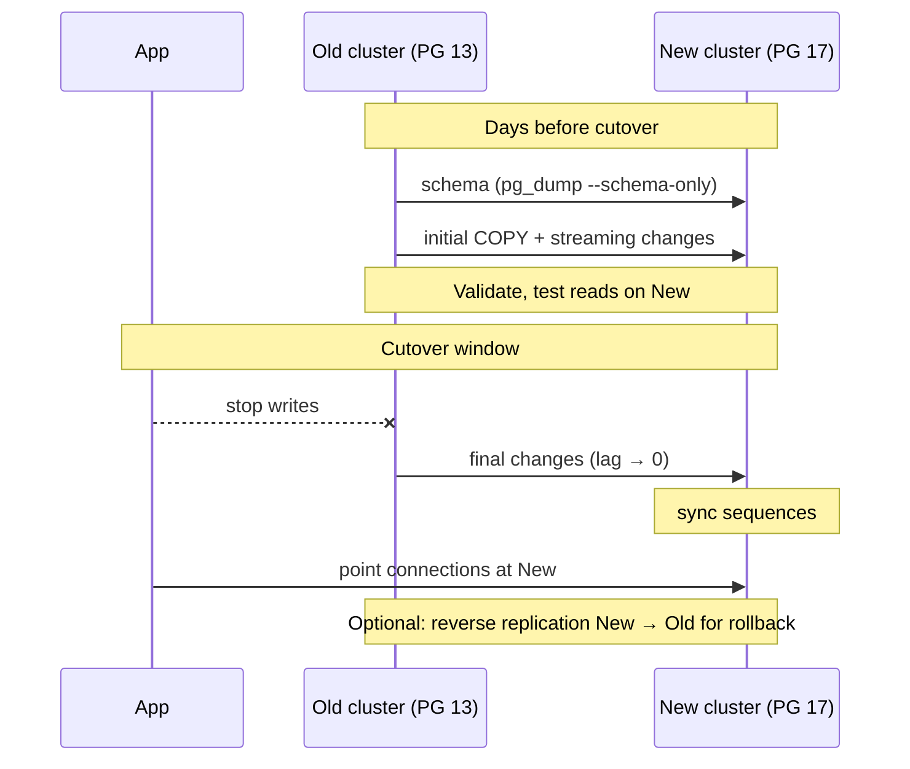

# Migration and upgrade patterns

## Major version upgrade with minimal downtime

Logical replication lets you upgrade (e.g. PG 13 → PG 17) with downtime of **seconds to minutes**, rather than the hours `pg_dump`/`pg_restore` needs for a large database, and without the in-place risk of `pg_upgrade`.



Outline:

1. Build the new cluster on the target version, same extensions installed.
2. Migrate roles: `pg_dumpall --globals-only` (edit out anything not wanted).
3. Copy schema, create publication on old, subscription on new. See [Operational procedures](operational-procedures.md#setting-up-logical-replication-step-by-step).
4. Wait for initial sync; run `ANALYZE` on the new cluster (statistics are not replicated).
5. Test the application read-only against the new cluster.
6. Cutover (see [checklist](#cutover-checklist-and-rollback-plan)).

See [Sample Major Version Upgrade](../setup-guides/sample-major-version-upgrade.md) for a worked example.

## On-prem to Aurora/RDS migration

Same pattern as a version upgrade, with managed-service constraints:

- **On-prem publisher → RDS/Aurora subscriber**: the most common direction.
    - On-prem: `wal_level = logical`, network path from AWS to on-prem (VPN / Direct Connect), `pg_hba.conf` entry for the RDS subnet.
    - RDS: create the subscription as the master user (`rds_superuser`).
    - Check extension availability on RDS before starting (`SELECT * FROM pg_available_extensions` on RDS).
- **RDS/Aurora publisher → anywhere**: set `rds.logical_replication = 1` (reboot). See [Managed-service specifics (AWS)](managed-service-specifics-aws.md).
- Large databases: the initial `COPY` over a WAN can take days. Consider raising `max_sync_workers_per_subscription` and deferring secondary indexes.
- **Alternatives**: AWS DMS (heterogeneous, managed), or a native dump/restore + logical catch-up.

## Cutover checklist and rollback plan

**Before the window**

- [ ] All tables in `pg_subscription_rel` are `r` (ready).
- [ ] Lag is consistently near zero.
- [ ] Row counts match for all tables (or checksums for critical tables).
- [ ] Indexes, constraints, triggers present on the new side; `ANALYZE` done.
- [ ] Large objects, materialized views, sequences plan ready.
- [ ] Roles, grants and `pg_hba.conf` on the new side tested with the application user.
- [ ] Sequence sync script tested.
- [ ] Rollback replication (new → old) prepared and tested if required.
- [ ] Connection switch method agreed (DNS, PgBouncer, config change).

**In the window**

1. Stop application writes to the old cluster (stop app, or `ALTER DATABASE app SET default_transaction_read_only = on` plus terminate existing sessions, or PgBouncer `PAUSE`).
2. Confirm no more changes: `confirmed_flush_lsn` of the slot equals `pg_current_wal_lsn()` on the old side (see *Publisher Slot LSN Distance* on the [SQL page](../sql/logical-replication-queries.md)).
3. Sync sequences. See [Operational procedures](operational-procedures.md#sequence-synchronisation-at-cutover).
4. On the new side: `ALTER SUBSCRIPTION ... DISABLE` (and later drop it).
5. (Optional) Create reverse replication new → old with `copy_data = false` for rollback.
6. Point the application at the new cluster; enable writes.
7. Smoke test.

**Rollback plan**

- **Before writes hit the new side**: just point the application back to the old cluster.
- **After writes hit the new side**: only safe if reverse replication was running, otherwise those writes are lost. With reverse replication, stop writes, wait for lag 0, sync sequences back, switch back.

**After**

- Drop the subscription on new and the publication/slot on old (an orphaned slot will fill the old cluster's disk).
- Keep the old cluster read-only for a while, then decommission it.

## pg_upgrade and slot/subscription preservation

Historically, `pg_upgrade` **did not preserve** logical slots, so upgrading a publisher or subscriber in place meant rebuilding replication.

**PG 17+** (when the **old** cluster is PG 17 or later):

- **Publisher**: logical slots are migrated, if all slots have consumed all WAL (`confirmed_flush_lsn` up to date), the new cluster has `wal_level = logical` and enough `max_replication_slots`. `pg_upgrade --check` verifies this.
- **Subscriber**: subscriptions and their replication origins / table sync states are preserved. All tables must be in state `r` or `i`, and `max_active_replication_origins` (PG 18; `max_replication_slots` before) must be large enough.

So for the first time, a PG 17 → PG 18 upgrade can keep logical replication running across an in-place upgrade. Upgrades **from** PG 16 and older still lose slots and subscriptions.

Rolling upgrade of a replicated pair (PG 17+): upgrade the subscriber first (it can run a newer version than the publisher), then the publisher.

## pg_createsubscriber

PG 17+ utility that converts a **physical standby** into a **logical subscriber**, without a `COPY` of the data:

```bash
pg_createsubscriber \
  --pgdata /var/lib/postgresql/17/standby \
  --publisher-server 'host=primary dbname=app user=postgres' \
  --database app \
  --publication pub_app \
  --subscription sub_app
```

What it does (the standby must be stopped first):

1. Creates the publication and logical slot on the primary.
2. Recovers the standby up to exactly the slot's consistent point.
3. Promotes it, changes its system identifier and creates the subscription starting from that point.

Use cases:

- Start logical replication for a **multi-terabyte** database without a long initial `COPY`.
- Combine with `pg_upgrade` for a near-zero-downtime upgrade: physical standby → `pg_createsubscriber` → `pg_upgrade` the new subscriber → cutover.

Notes: it requires `wal_level = logical` on the primary, works on whole databases (publication `FOR ALL TABLES`), and the converted node can't be used as a standby afterwards. Use `--dry-run` first. PG 18 adds `--all` (all databases) and `--clean` options.
