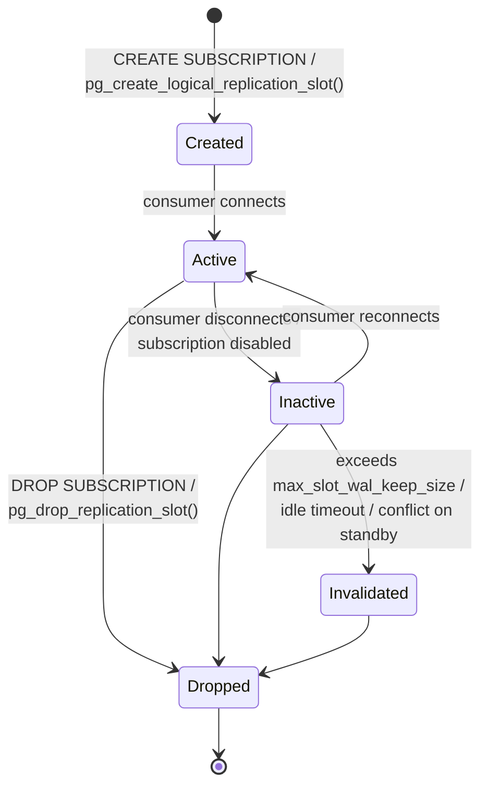

# Replication slots

## Logical slot lifecycle



1. **Creation**: waits for a consistent snapshot (blocked by long-running transactions on the publisher).
2. **Active**: a walsender is streaming from it (`active = true`, `active_pid` set).
3. **Inactive**: no consumer connected. WAL and catalog rows are still retained.
4. **Invalidated** (PG 13+): the server gave up retaining WAL for it. It can never be used again.
5. **Dropped**: retention released.

Slots are **persistent**: they survive restarts and are stored in `pg_replslot/`.

```sql
-- create / drop manually
SELECT * FROM pg_create_logical_replication_slot('my_slot', 'pgoutput');
SELECT pg_drop_replication_slot('my_slot');   -- fails if active; stop the consumer first
```

## WAL retention and disk exhaustion risk

A slot prevents removal of any WAL from its `restart_lsn` onwards, **regardless** of `max_wal_size` or `wal_keep_size`. If the consumer stops (subscriber down, subscription disabled, network broken, CDC tool crashed), WAL accumulates until the disk fills and the **publisher stops** (PANIC on WAL write failure).

```sql
-- WAL retained by each slot
SELECT slot_name, slot_type, active, wal_status,
       pg_size_pretty(pg_wal_lsn_diff(pg_current_wal_lsn(), restart_lsn))        AS retained_wal,
       pg_size_pretty(pg_wal_lsn_diff(pg_current_wal_lsn(), confirmed_flush_lsn)) AS lag
FROM pg_replication_slots
ORDER BY pg_wal_lsn_diff(pg_current_wal_lsn(), restart_lsn) DESC NULLS LAST;
```

!!! danger "Most common logical replication outage"
    An unused slot filling the disk is the single most common way logical replication takes down a production publisher. **Alert on retained WAL per slot**, and on inactive slots.

Logical slots also hold back **`catalog_xmin`**, preventing vacuum from cleaning dead rows in system catalogs. This leads to catalog bloat and, in extreme cases, transaction ID wraparound pressure.

## max_slot_wal_keep_size and slot invalidation

PG 13+: cap how much WAL a slot can hold.

```sql
ALTER SYSTEM SET max_slot_wal_keep_size = '100GB';   -- default -1 = unlimited
SELECT pg_reload_conf();
```

`pg_replication_slots.wal_status`:

| Value | Meaning |
|---|---|
| `reserved` | Retained WAL within `max_wal_size` |
| `extended` | Beyond `max_wal_size` but within `wal_keep_size` / `max_slot_wal_keep_size` |
| `unreserved` | Required WAL is about to be removed at the next checkpoint |
| `lost` | Required WAL removed. The slot is **invalidated** |

`safe_wal_size` shows how many more bytes can be written before the slot is at risk.

PG 17+ shows *why* a slot was invalidated in `invalidation_reason` (`wal_removed`, `rows_removed`, `wal_level_insufficient`, and from PG 18 `idle_timeout`).

PG 18+ also has `idle_replication_slot_timeout`: invalidate slots that have been inactive for longer than the given time.

Trade-off: a cap **protects the publisher** but means a subscriber that falls too far behind must be **fully resynchronised** (drop and recreate the subscription with `copy_data = true`). For most production publishers, that is the right trade.

## Inactive and orphaned slots

Causes:

- Subscription disabled and forgotten.
- Subscription dropped with `slot_name = NONE` and the slot not dropped on the publisher.
- Subscriber server decommissioned / restored from backup elsewhere.
- CDC tool (Debezium, DMS) task deleted without cleanup.
- Tablesync slots left behind by an interrupted sync (`pg_<subid>_sync_...`).

```sql
-- inactive logical slots and how long they've been inactive (inactive_since is PG 17+)
SELECT slot_name, database, plugin, active, inactive_since,
       pg_size_pretty(pg_wal_lsn_diff(pg_current_wal_lsn(), restart_lsn)) AS retained_wal,
       age(catalog_xmin) AS catalog_xmin_age
FROM pg_replication_slots
WHERE slot_type = 'logical' AND NOT active;
```

```sql
-- on the subscriber: which slots are still in use
SELECT subname, subslotname, subenabled FROM pg_subscription;
```

Before dropping a slot, confirm nothing uses it: check every known subscriber and CDC tool. A dropped slot can't be recovered; the consumer must resync.

## Failover slots and slot synchronisation to standbys

Before PG 17, logical slots existed **only on the primary**. After a physical failover, the new primary had no slot and every subscriber had to be rebuilt.

PG 17 adds **failover slots**:

```sql
-- subscriber: mark the subscription's slot as a failover slot
CREATE SUBSCRIPTION sub_app CONNECTION '...' PUBLICATION pub_app WITH (failover = true);
-- or for an existing one (subscription must be disabled)
ALTER SUBSCRIPTION sub_app SET (failover = true);
```

Configuration:

| Where | Setting |
|---|---|
| Physical standby | `sync_replication_slots = on` |
| Physical standby | `hot_standby_feedback = on` |
| Physical standby | `primary_slot_name` set (physical slot on the primary) |
| Physical standby | `primary_conninfo` includes `dbname=...` |
| Primary | `synchronized_standby_slots = 'standby1_physical_slot'`: logical walsenders wait for these standbys before sending, so subscribers never get ahead of the failover candidate |

The **slotsync worker** on the standby copies failover slots from the primary (`pg_replication_slots.synced = true` on the standby). After promotion, point the subscription's `CONNECTION` at the new primary and it continues.

```sql
-- standby: synced slots ready for failover
SELECT slot_name, synced, temporary, failover, conflicting
FROM pg_replication_slots;
```

## Slots on standbys

PG 16+ allows **logical decoding on a physical standby**: you can create a logical slot on a standby and subscribe from it, offloading decoding from the primary.

- Requires `wal_level = logical` on the **primary** and `hot_standby_feedback = on` (recommended) on the standby.
- Slots on a standby can be **invalidated by recovery conflicts** (e.g. required catalog rows vacuumed on the primary). `conflicting = true` in `pg_replication_slots` shows this.
- Slot creation on a standby may wait for activity on the primary to reach a consistent point. Running `SELECT pg_log_standby_snapshot();` on the primary can speed this up.
- On promotion, these slots remain usable on the new primary.

Different from PG 17 failover slots: slots on a standby are *independent* slots for consumers reading from the standby, while failover slots are *copies* of primary slots kept ready for promotion.
