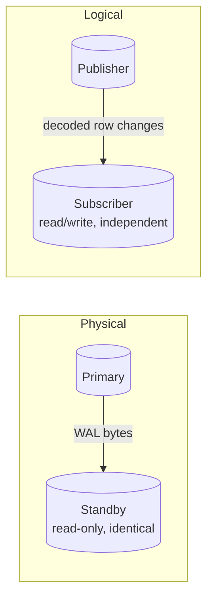
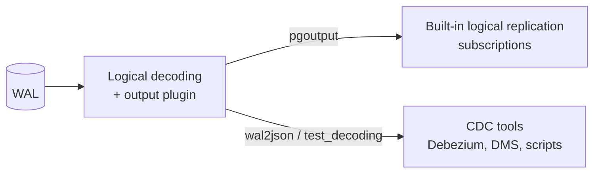

# What is logical replication?

## Definition and scope

Logical replication copies **data changes** (rows inserted, updated, deleted and tables truncated) from one PostgreSQL database to another. It does this at the level of *rows and tables*, not disk blocks.

It works on a **publish / subscribe** model:

- A **publisher** defines one or more *publications*: sets of tables whose changes are sent out.
- A **subscriber** defines a *subscription* that connects to the publisher, copies the existing data once, then streams and applies changes as they are committed.

Key properties:

- **Per table**: you choose which tables (and optionally which rows and columns) are replicated.
- **Writable target**: the subscriber is a normal read/write database. It can have extra tables, indexes, triggers and even its own writes to replicated tables (with care).
- **Cross version / cross platform**: publisher and subscriber can run different PostgreSQL major versions, OS or CPU architecture.
- **Transactional**: changes are applied on the subscriber in publisher commit order, one transaction at a time, so the subscriber is always transactionally consistent (but may be behind).
- **Data only**: schema (DDL), sequences, large objects and similar objects are **not** replicated. See [Limitations](limitations-and-non-replicated-objects.md).

## Logical vs physical replication

| | Physical (streaming) replication | Logical replication |
|---|---|---|
| Unit of replication | WAL records / disk blocks for the whole cluster | Row changes for selected tables |
| Granularity | Entire cluster (all databases) | Per table, optionally per row/column |
| Target | Read-only hot standby, byte-identical | Independent read/write database |
| Major versions | Must match exactly | Can differ (e.g. 13 → 17) |
| Architecture / OS | Must match | Can differ |
| DDL | Replicated (it's all WAL) | Not replicated |
| Sequences | Replicated | Not replicated (until PG19, see [Version history](version-history.md)) |
| Indexes on target | Same as primary | Can be different |
| Failover target | Yes, designed for it | Possible, but needs extra work (sequences, slots) |
| `wal_level` | `replica` | `logical` |
| Typical lag source | Network / replay I/O | Single-threaded apply, large transactions |

## Logical replication vs logical decoding

These terms are often mixed up:

- **Logical decoding** (since PG 9.4) is the low-level *engine*: it reads WAL and turns it into a stream of row-level changes via an **output plugin**, tracked by a **logical replication slot**. Anything can consume it: `pg_recvlogical`, Debezium, AWS DMS, custom code.
- **Logical replication** (since PG 10) is the built-in *feature* that uses logical decoding with the `pgoutput` plugin plus `CREATE PUBLICATION` / `CREATE SUBSCRIPTION` to replicate between PostgreSQL databases.

## Typical use cases

- **Major version upgrades with minimal downtime**: replicate from old version to new, cut over in seconds. See [Migration and upgrade patterns](migration-and-upgrade-patterns.md).
- **Platform migrations**: on-prem → RDS/Aurora, cloud → cloud, x86 → ARM.
- **Selective replication**: send a subset of tables (or rows/columns) to a reporting database, data warehouse staging area or a different service.
- **Consolidation**: several databases replicating into one central database.
- **Fan-out / distribution**: one publisher feeding several subscribers.
- **Change data capture (CDC)**: stream changes to Kafka, search indexes or caches via logical decoding.
- **Online table restructuring**: replicate into a differently partitioned or indexed copy of a table, then swap.

## When not to use logical replication

- **High availability / failover for a whole cluster**: use physical streaming replication. It covers everything (DDL, sequences, all databases) and is simpler to promote.
- **Schema changes happen constantly**: every DDL change must be applied manually on both sides.
- **Tables without a primary key** that receive many `UPDATE`/`DELETE`s, and where adding a key is not possible: `REPLICA IDENTITY FULL` works but is expensive.
- **Very high write rates on a single table**: apply is mostly single-threaded per subscription; the subscriber may never catch up.
- **You need exact replicas of everything**: large objects, sequences (pre-PG19), roles, extensions, materialized views and DDL are not carried over.
- **Point-in-time recovery / backups**: logical replication propagates mistakes (a `DELETE` without `WHERE` is replicated too). It is not a backup.
