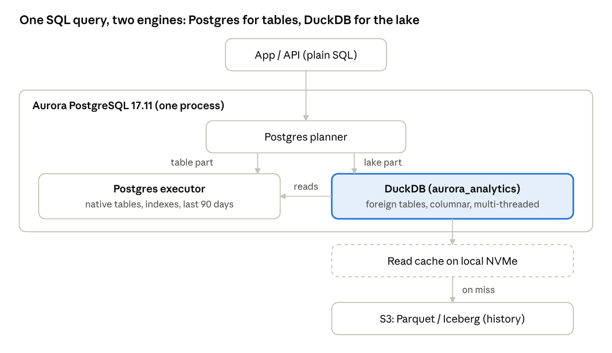
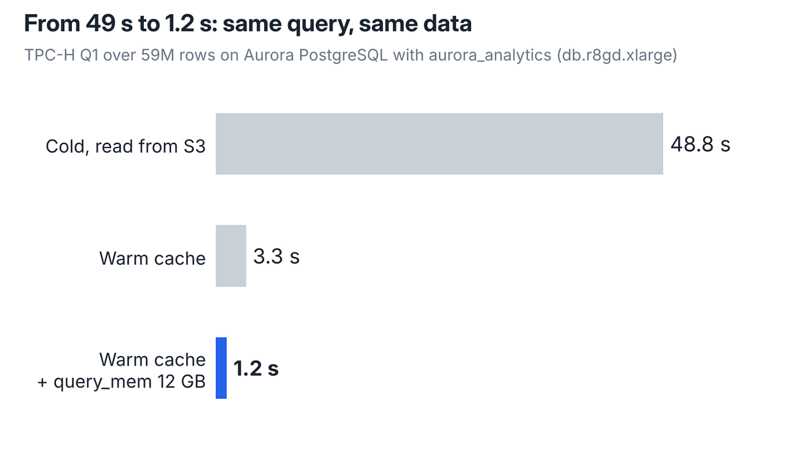
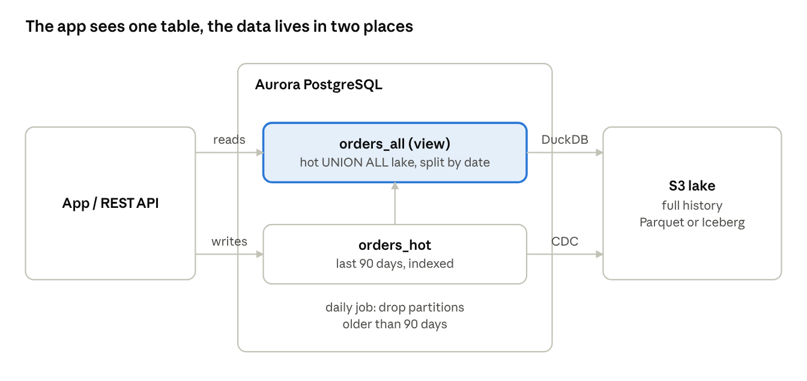

# Aurora PostgreSQL now has DuckDB inside. I tested it on 59 million rows

!!! info "Source"
    **Gianfranco Arena** in *Towards AWS* (Medium) · 13 Oct 2026 · 8 min read ·
    [Original article](https://towardsaws.com/aurora-postgresql-now-has-duckdb-inside-i-tested-it-on-59-million-rows-cdfeeaf5ace6)

**Can your Postgres app read years of history straight from the lake?**

In August, Amazon [announced it is acquiring DuckLabs](https://www.aboutamazon.com/news/company-news/aws-ducklabs), the company behind DuckDB. A month later, on September 30, DuckDB showed up inside Aurora PostgreSQL: the new `aurora_analytics` extension lets you query Parquet and Iceberg files on S3 with plain SQL, and the analytical part of the query runs on an embedded DuckDB.

I’ve been running DuckDB inside Lambda for a while (that’s the series on DuckDB and Unity Catalog), so I wanted to see what changes when it lives inside the database instead.

The question I tried to answer is a practical one. Keep the last 90 days of orders in Aurora, leave the history in Parquet on S3, put one SQL view on top and an API in front of it. Is that fast enough? Where does it break? What does it cost?

Short answer: a customer page that reads both sides answered in **155 ms**, a full scan of 59 million rows took **1.2 seconds** once warm, and the first cold read of the same data took **49 seconds**. Most of this article is about the gap between those numbers.

## How it works

You create a foreign table that points at a Parquet file, a folder, or an Iceberg table in Glue or S3 Tables. From then on it is a normal table in SQL: you can select from it, join it, put it in a view.



The planner sends the lake part of the query to DuckDB, which reads only the columns it needs and pushes filters down to the files. Data read from S3 is cached on the instance’s local disk and shared by every session. The detail that surprised me: when a query joins a lake table with a native Aurora table, DuckDB reads the Postgres table itself (`POSTGRES_SCAN` in the plan) and runs the whole join on its side.

It’s read-only on the lake. You can copy data into Aurora with `CREATE TABLE AS`, `INSERT … SELECT` or `MERGE INTO`, but you can’t write Parquet back to S3 and your Aurora tables don’t become Iceberg. The feature has [no extra charge](https://aws.amazon.com/blogs/aws/amazon-aurora-postgresql-now-supports-direct-querying-of-apache-iceberg-and-parquet-data-in-your-data-lake/): you pay the instance and the S3 requests.

## The lab

Everything is one CDK stack, so anyone can rebuild it and tear it down with one command:

- Aurora PostgreSQL 17.11, one db.r8gd.xlarge writer (4 vCPU, 32 GiB, local NVMe for the cache), in Frankfurt.
- A VPC with private subnets only and an S3 gateway endpoint. No NAT, no public IP. I talked to the database through the RDS Data API.
- TPC-H at scale factor 10, generated by DuckDB in a CodeBuild job: 5.6 GB of Parquet, 59 million rows in `lineitem`, 15 million in `orders`, 1.5 million customers. A second copy of `lineitem` is hive-partitioned by ship year.

I used TPC-H because it’s the standard for analytical benchmarks and anyone who clones the repo gets exactly the same data. Every timing is the Execution Time from `EXPLAIN (ANALYZE)`, so it’s server-side and doesn’t include the network. “Cold” means the first time those columns were read, with nothing in the cache. “Warm” means the same columns were already on the local disk.

## Five things the announcement doesn’t tell you

1. **The feature is off by default.** `aurora_analytics.enabled` is false and the default parameter group can’t be changed, so you need a custom cluster parameter group. The [docs](https://docs.aws.amazon.com/AmazonRDS/latest/AuroraUserGuide/aurora-analytics-prerequisites.html) say it, the launch post doesn’t.
2. **CDK doesn’t know the feature name yet.** It only offers `s3Import` and `s3Export` for cluster roles, so I attached the `AuroraAnalytics` role through the L1 construct. CloudFormation’s validator also doesn’t know engine 17.11 yet and prints a warning; the deploy works anyway.
3. **Always set region on the foreign table.** Without it, Aurora asks the global S3 endpoint where the bucket lives. From a private subnet with only the regional gateway endpoint, that call times out after 2 seconds and the `CREATE FOREIGN TABLE` fails.
4. **Hive partitions need a glob.** Pointing `location` at the folder didn’t read the `ship_year=1995/` subfolders. With `…/lineitem/*/*.parquet` it worked, picked up `ship_year` as a column and skipped files on it.
5. **Raise query_mem.** The default on this instance is about 4 GB, and with it DuckDB ran my queries on a single thread. More on that below.

The foreign table itself is short:

```sql
CREATE FOREIGN TABLE ft_orders ()
SERVER aurora_analytics_server
OPTIONS (location 's3://<bucket>/tpch/sf10/flat/orders/',
         format 'parquet', region 'eu-central-1');
```

The empty column list lets Aurora read the schema from the Parquet footer. It got every type right: dates, numerics, bigints.

## The numbers

The local cache decides almost everything. The same TPC-H Q1 over 59 million rows took 48.8 s on the first run and 3.3 s on the second: 1,532 S3 GETs and 782 MB from S3 the first time, 2 GETs the second.



The setting that surprised me most is `query_mem`. With the default (about 4 GB on an xlarge) the plan showed `Effective Parallelism: 1.0`. After `ALTER DATABASE lab SET aurora_analytics.query_mem = '12GB'` it went to 4.0, and warm Q1 dropped from 3.3 s to 1.2 s. The [docs](https://docs.aws.amazon.com/AmazonRDS/latest/AuroraUserGuide/aurora-analytics-tuning-query-mem.html) say threads scale with the memory budget, but I didn’t expect a 3x difference from one parameter. The catch is concurrency: more memory per query means fewer heavy queries at the same time.

File layout matters as much as the engine. Reading one year of `lineitem` touched 1 of 7 files when the data was partitioned by year, 46 MB instead of 398 MB. The customer page on the lake alone has to scan the whole orders column, because the files are ordered by order key and not by customer. If I wanted it faster, this is where I’d start: sort or partition the lake the way the app filters it.

I didn’t expect this one: joins between Aurora and the lake run inside DuckDB. The plan showed `POSTGRES_SCAN` on the native table. DuckDB pulled 567k rows from Aurora and joined them with 15 million orders and 1.5 million customers in 1.4 s.

And a small trap. I added `current_setting()` to the select list of Q1 to check a parameter, and the same query went past the Data API’s 45-second limit. My guess is that it broke the pushdown to DuckDB. Keep the lake part of a query to plain columns and operators.

## The use case: hot in Aurora, history in the lake

This is a problem I’ve seen again and again in data platform projects. The application runs on Postgres, but customer care wants to see years of history. You either keep everything in the operational database (big tables, slow vacuum and backups, expensive storage) or you move the history to the lake and add a second engine and a second connection to the app.



The app writes to Aurora as it always did. CDC ships every change to the lake, so the lake has the full history. A daily job drops the partitions older than 90 days from Aurora. The app only ever queries one view:

```sql
CREATE VIEW orders_all AS
SELECT o_orderkey, o_custkey, o_totalprice, o_orderdate, 'hot' AS tier
FROM orders_hot
UNION ALL
SELECT o_orderkey, o_custkey, o_totalprice, o_orderdate, 'lake' AS tier
FROM ft_orders
WHERE o_orderdate < DATE '1998-05-04';
```

The date filter on the lake side keeps the two halves from overlapping. In production it moves with the cut-off; in the lab it’s fixed, because TPC-H orders end in August 1998.

What made this work is that Postgres pushes the customer filter through the view. The plan showed an index scan on `orders_hot` and, on the lake side, DuckDB reading `ft_orders` with `o_custkey = 693448` and the date filter, both pushed into the Parquet scan. Postgres then merges the two sorted streams. The whole thing took 155 ms with a warm cache.

An API on top doesn’t need to know any of this. A Lambda with the Data API, or any backend with a Postgres driver, queries `orders_all` like any other table.

## When I’d use it, and when I wouldn’t

For me it fits two jobs: giving a Postgres application access to its own history, and replacing the small ETL jobs that copy lake data into the database. It doesn’t replace a warehouse, and it won’t serve hot traffic from S3.

- **History page in an app (customer, account, device): yes.** 155 ms through one view, with a warm cache.
- **Join operational data with the history: yes.** 1.4 s for 567k active customers against 15M orders, no second engine.
- **Load lake data into Aurora on a schedule: yes.** `CREATE TABLE AS` or `MERGE INTO` from SQL, 3.9 s for 15M rows into 1M.
- **High-traffic endpoint, single-digit ms: no, materialize.** 0.05 ms from a native table vs 155 ms; AWS says the same in the docs.
- **BI with many users and heavy scans: no.** Memory per query limits concurrency; Athena, Redshift or Databricks fit better.
- **Data nobody has read in a while: expect the cold time.** 4 s to 49 s on the first read from S3.

On cost: the feature itself is free. My heaviest cold query made 1,532 S3 GET requests, which at S3’s per-thousand pricing is a fraction of a cent, and data transfer is zero inside the region through the gateway endpoint. The real cost is the instance: the memory and CPU a lake query uses is taken away from the transactional workload. If the analytical reads grow, the docs suggest moving them to a dedicated reader, and that’s what I’d do.

Three things I’d set on day one: `region` on every foreign table, `query_mem` sized to the instance, and a lake layout (partitions or sort order) that matches how the app filters.

## Try it yourself

The CDK stack, the data generator, the SQL and the raw results are on GitHub: [zdotfive/aurora-duckdb-lab](https://github.com/zdotfive/aurora-duckdb-lab). It doesn’t need `cdk bootstrap`, and the teardown script in the repo removes everything when you’re done. Leave the instance running and it bills you by the hour, so don’t forget that part.

Next, I want to try the other direction: gold tables built in Databricks, written as Iceberg, read by the app on Aurora with no reverse ETL in between. I don’t know yet if it works. That’s what part 2 is for.

If you try this on your own data, I’d like to hear what numbers you get.

*Originally published on [LinkedIn](https://www.linkedin.com/pulse/aurora-postgresql-now-has-duckdb-inside-i-tested-59-million-arena-uxfif/).*
